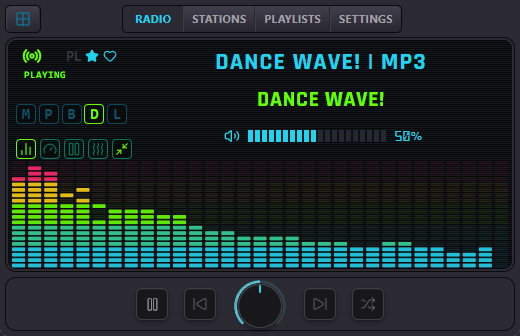

# AmpPulse — Releases & Support

**Ampulsive by nature.**  
*Lightweight desktop internet radio & audio player built with Rust & Tauri.*

  
  
  
  

  <a href="https://github.com/AmpPulseApp/amppulse/releases/latest"><strong>⬇️ Download Latest Release</strong></a>
  &nbsp;&bull;&nbsp;
  <a href="https://amppulse.netlify.app/"><strong>🌐 Official Website</strong></a>
  &nbsp;&bull;&nbsp;
  <a href="https://github.com/AmpPulseApp/amppulse/issues"><strong>🐛 Report a Bug / Request Feature</strong></a>

 

> **Note:** AmpPulse is proprietary (closed-source) software. This repository hosts official compiled releases, version changelogs, and community issue tracking.

---

## Highlights

* **The Sweet Spot:** Built to replace crashing legacy players like RadioSure—and modern alternatives that are either too barebones or overly cluttered. Classic Winamp speed on a clean **Rust + Tauri** core.
* **Ultra-Lightweight Footprint:** ~4 MB installer, ~3.5 MB Rust core RAM (+ shared OS WebView2, staying under ~100 MB total in compact mode), and ~0.2–0.5% CPU usage.
* **Privacy First (Zero Telemetry):** No user accounts, no login walls, no usage analytics, and no crash telemetry sent anywhere. All settings, favorites, and playlists are stored locally on your PC.
* **Flexible Interface:** Classic Tabs, Compact bar, or Dynamic 2x2 Grid (up to 4 swappable panels), plus 4 themes (*Dark*, *Night Amber*, *Light*, *Paper*).
* **Visualizers & Audio Control:** 1/3/5-zone spectrum analyzer, VU meter, L/R channel bars, custom output devices, fade/reconnect, sleep timer, and global/hardware media hotkeys.
* **Radio Discovery:** Browse thousands of stations worldwide via the **Radio-Browser.info** API with country/genre filters, unlimited custom URLs, playlists, and 5 quick-pins.

---

## Download & Installation

1. Go to the [**Latest Release**](https://github.com/AmpPulseApp/amppulse/releases/latest) page and download the Windows installer (`.exe` or `.msi`).
2. **System Requirements:** Windows 10 or Windows 11 (64-bit) with Microsoft Edge WebView2 *(pre-installed on Windows 11 and updated Windows 10 systems)*.  
   *macOS and Linux builds are planned once cross-platform testing is complete.*

### Windows SmartScreen Notice
Because AmpPulse is an independent release and the installer is not yet signed with a commercial Code Signing certificate, Windows SmartScreen may show a **"Windows protected your PC"** prompt on first launch:
1. Click **More info**
2. Click **Run anyway**

To verify file integrity, every release includes **SHA-256 checksums** in the release notes.

---

## Lite vs. Pro

AmpPulse **Lite** is free forever with no ads and no time limits. **Pro** is an optional one-time perpetual license for v1.x (includes all v1.x updates, no subscriptions).

| Feature | Lite (Free) | Pro (v1.x) |
| :--- | :--- | :--- |
| **Stations** | 20 built-in + 3 custom URLs | Unlimited custom stations |
| **Radio-Browser API Search** | — | Full API access & country/genre filters |
| **Playback Navigation** | Next/Prev & Random switcher | Playlist-based & global switching |
| **Favorites & Playlists** | — | Unlimited playlists, favorites & 5 quick-pins |
| **Interface Layout** | Compact & Tab view | Tabs + Dynamic 2x2 Grid + Compact |
| **Themes** | Classic Dark | Dark, Light, Night (Amber), Paper |
| **Visualizers** | Spectrum analyzer | Spectrum + VU Meter + L/R Bars + BG effect |
| **Hotkeys & Media Keys** | — | Global shortcuts & hardware media keys |
| **Upcoming Audio Tools** | — | Equalizer, Local Files, History & Record |

Full feature details and current pricing are available on the [**Official Website**](https://amppulse.netlify.app/#pricing).

---

## Roadmap

- [ ] **Tauri Auto-Updater** — seamless updates via GitHub Releases
- [ ] **Stream Recording** — record live broadcasts directly to local audio files
- [ ] **10-Band Equalizer** — custom presets and frequency tuning
- [ ] **Local File Playback & History** — play MP3/FLAC/OGG libraries alongside radio
- [ ] **macOS & Linux Support**

---

## Bug Reports & Feedback

Found a bug, audio glitch, or have a feature idea?  
Please open an issue in the [**Issues tab**](https://github.com/AmpPulseApp/amppulse/issues). When reporting a bug, include:
* Your Windows version and AmpPulse version
* Steps to reproduce the issue
* Screenshots or error messages (if applicable)

---

## Credits & Attribution

* **Station Directory:** Powered by the open community [**Radio-Browser.info**](https://www.radio-browser.info/) API.
* **Icons:** UI icons from [**Lucide**](https://lucide.dev/) (ISC License).
* **Core Stack:** Built with [**Tauri**](https://tauri.app/), **Rust**, and **React**.

---

  Warning: may cause ampulsive behavior. &bull; Built by TKALEX &bull; 2026

